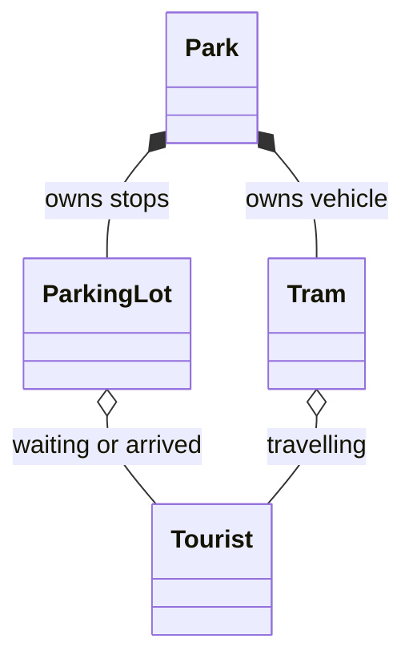

# Python Programming Exercises: project walkthrough

[Overview](../README.md) · [Code reference](CODE_REFERENCE.md) · [Development guide](DEVELOPMENT.md)

## Separate programs with a common learning context

There is no combined application entry point. Run the script for the exercise you want. Current modules can be imported without launching prompts, which also makes their functions/classes available to tests. This is not a stable public library API.

| Script | Main job | Objects to inspect |
| --- | --- | --- |
| [Transposition.py](../Transposition.py) | Reorder characters in text files, then reverse the operation | `transpose`, `untranspose`, `transform_file` |
| [Image Filters.py](../Image%20Filters.py) | Create grayscale or reduced-blue output | `grayscale_look`, `vintage_look`, Pillow images |
| [Sentiment Analysis.py](../Sentiment%20Analysis.py) | Summarize review-word ratings | `findscore`, `average`, `standard_deviation`, `process_list`, `report` |
| [Amusement Park Tram.py](../Amusement%20Park%20Tram.py) | Move tourists between parking lots | `Park`, `ParkingLot`, `Tram`, `Tourist` |
| [LostLuggage.py](../LostLuggage.py) | Simulate luggage routing between named airports | `main`, counters, random route choices |
| [SliceProgram.py](../SliceProgram.py) | Quiz the user about string slices | `main`, generated strings, boundaries/steps |
| [Stocks.py](../Stocks.py) | Explain the incomplete stock draft | Launcher returning status 2 |
| [legacy/Stocks.py.txt](../legacy/Stocks.py.txt) | Preserve the unfinished original verbatim | Historical source, not a runnable module |

## Text and image paths

`transpose` places even-indexed characters before odd-indexed characters. `untranspose` interleaves those halves again. `transform_file` applies the operation line by line, handles UTF-8, preserves LF/CRLF in the tested cases, and rejects identical input/output paths. It is a learning cipher, not secure encryption.

Pillow opens the image inputs. Grayscale creates intensity values and saves RGB output. Vintage preserves red/green and halves blue. The CLI rejects overwriting the source path, and tests inspect actual pixel values for grayscale/RGBA inputs.

## What the sentiment statistics mean

The expected `movieReviews.txt` is not included. Each line needs a numeric rating followed by review text. Matching is case-insensitive and whole-word based. Two occurrences in one review contribute its rating twice: the unit is a word occurrence, not a unique review.

`process_list` returns `(word, occurrence_count, average_rating, population_standard_deviation)` rows. Unseen words have zero occurrences and NaN statistics. `report` sorts by a selected tuple field. These are descriptive summaries of supplied ratings, not a trained sentiment model.

## The tram’s objects

`Park` constructs stops, tourists, and a tram, then advances the simulation. `ParkingLot` stores a wait list and boards people travelling in the vehicle’s direction. `Tram` moves between stop indices, boards/unloads, and reverses at the ends. `Tourist` stores its start, destination, and arrival flag. `randstart` chooses valid distinct stop indices. Unloading iterates over a copy so two people reaching the same stop are both removed correctly.

This is a teaching simulation, with no validated capacity, schedule, passenger demand, or transport-performance model. Lost-luggage probabilities and remaining slice-game input edge cases likewise remain historical teaching choices.

## The unfinished stock exercise

The draft lacks its required CSVs and a clear input schema. Its original malformed source is retained in the legacy text file. The current launcher reports the missing prerequisites and exits instead of inventing a return calculation. See [development](DEVELOPMENT.md) for per-program commands and the [reference](CODE_REFERENCE.md) for all defined functions and class methods.
